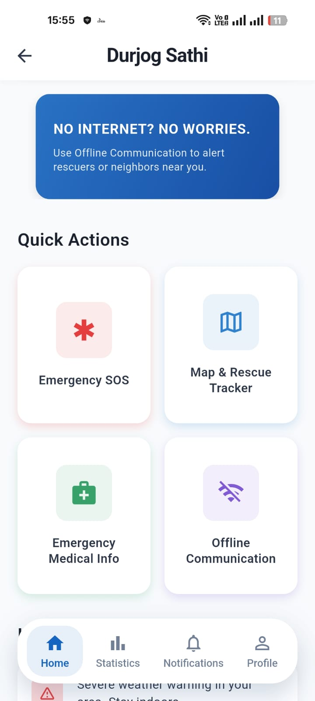
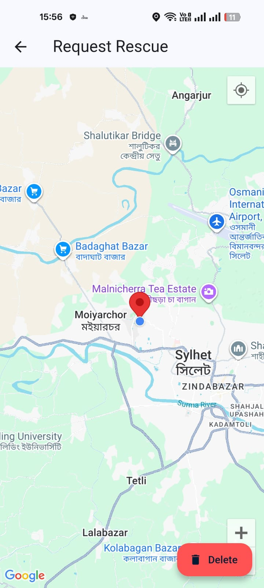
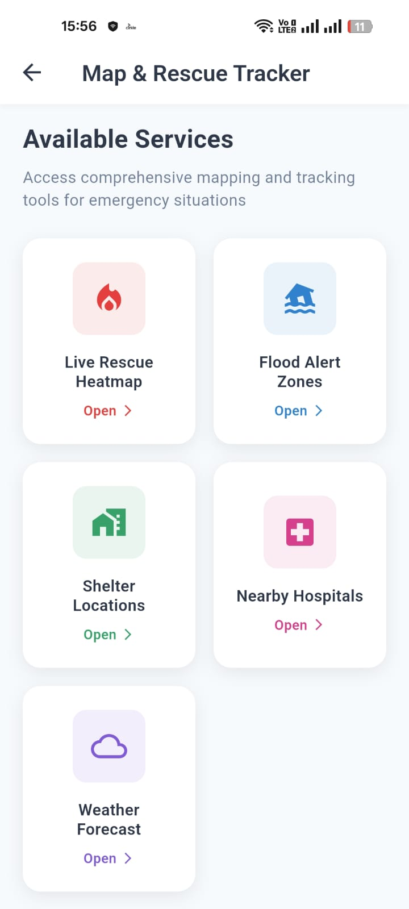
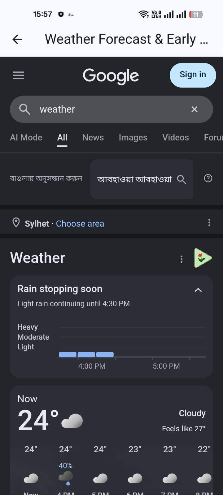
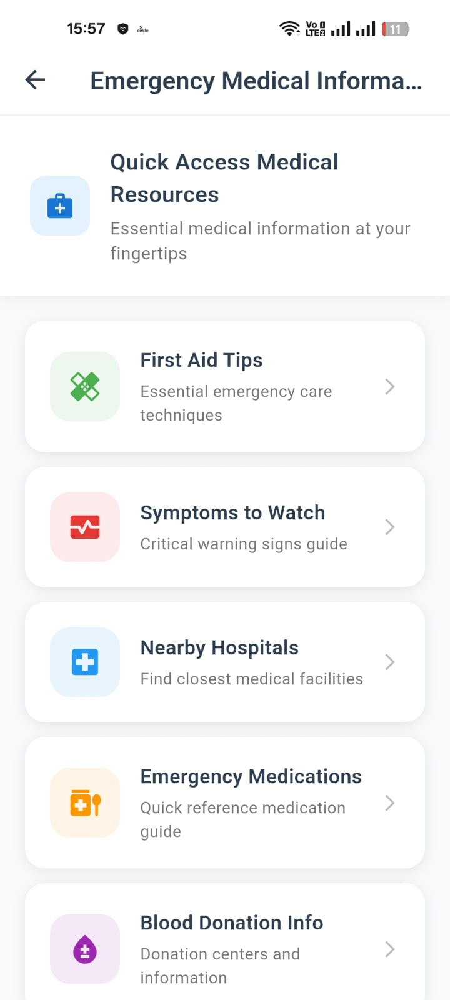
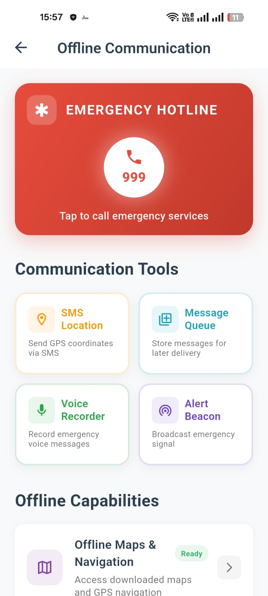
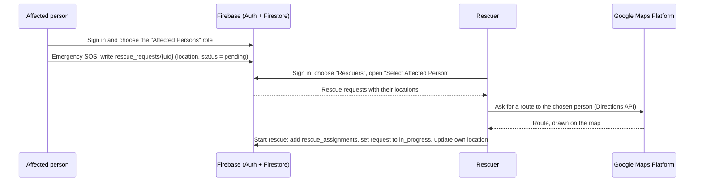

# Durjog Sathi (দুর্যোগ সাথী)

**A disaster companion app that connects people affected by floods and other emergencies with rescuers.** An affected person can send an SOS with their GPS location, a rescuer can pick someone to help and get a route to them, and everyone can reach shelters, hospitals, flood and weather information, and offline first-aid guidance.


## Screenshots

<table>
  <tr>
    <td align="center"><br><sub>Welcome</sub></td>
    <td align="center"><br><sub>Role selection</sub></td>
    <td align="center"><br><sub>Home</sub></td>
  </tr>
  <tr>
    <td align="center"><br><sub>Emergency SOS</sub></td>
    <td align="center"><br><sub>Map and rescue tracker</sub></td>
    <td align="center"><br><sub>Rescuer dashboard</sub></td>
  </tr>
</table>

## Contents

- [Why this project](#why-this-project)
- [Features and status](#features-and-status)
- [How it works](#how-it-works)
- [Tech stack](#tech-stack)
- [Getting started](#getting-started)
- [Firestore data model](#firestore-data-model)
- [Project structure](#project-structure)
- [Known limitations and roadmap](#known-limitations-and-roadmap)
- [Authors](#authors)

## Why this project

Bangladesh is one of the most flood-prone countries in the world. When water rises, the hard parts are knowing who needs help, where they are, and who is close enough to reach them, often with unreliable connectivity. Durjog Sathi ("Disaster Companion") is a mobile app that puts those pieces in one place: a way to ask for help with your location, a way for rescuers to find and navigate to people who asked, and the safety information people need while waiting.

This is a student project. The core rescue flow works end to end, while several screens are still prototypes that use sample data. The [status table](#features-and-status) below says which is which.

## Features and status

**Working** means the feature does what it says. **Prototype** means the screen exists but uses sample or in-memory data. **Planned** means it is shown in the UI but not built yet.

| Area | Feature | Status |
|---|---|---|
| **Accounts** | Sign up and log in with email and password, Google sign-in, password reset, session kept between launches | Working |
| **Accounts** | Role selection: **Affected Persons** and **Rescuers** | Working |
| **Accounts** | Role portals for **Medical Response Unit** and **Military Assistance** | Planned |
| **Affected person** | **Emergency SOS:** share your GPS location as a rescue request, see it on the map, delete it | Working |
| **Affected person** | **Nearby hospitals** within 20 km (Google Places) | Working |
| **Affected person** | **Flood alert zones** (Bangladesh Flood Forecasting and Warning Centre, shown in an in-app web view) | Working |
| **Affected person** | **Weather forecast** (in-app web view) | Working |
| **Affected person** | **First aid tips** for earthquakes, floods, fires and storms, available without internet | Working |
| **Affected person** | **Offline communication:** one-tap call to 999 | Working |
| **Affected person** | Offline communication: SMS your location, Wi-Fi and Bluetooth mesh messaging | Planned |
| **Affected person** | **Shelter locations:** tap the map to add a shelter with its capacity and free space | Prototype (kept in memory, not saved) |
| **Affected person** | **Emergency contacts:** default list, add your own | Prototype (kept in memory, not saved) |
| **Affected person** | **Live rescue heatmap** and rescue tracking with route drawing | Prototype (fixed demo destination and sample rescuer markers around Dhaka) |
| **Affected person** | **Statistics** charts | Prototype (sample data) |
| **Affected person** | Home alerts, notifications, profile card | Prototype (placeholder content) |
| **Affected person** | Other medical info (symptoms, medications, blood donation, injury types, resources) | Planned |
| **Rescuer** | See people who sent an SOS on a map, select one, and **start a rescue** (route drawn with Google Directions) | Working |
| **Rescuer** | Urgent alerts, status reporting, messaging, team coordination, rescue history | Planned |

## How it works



The app opens on an **auth gate**: signed-in users go straight to their home screen, everyone else sees the welcome page. After login, the **role screen** decides which experience you get.

## Tech stack

| Layer | Technology |
|---|---|
| App | Flutter (Dart 3.7+), Material 3 |
| Auth | Firebase Authentication (email and password, Google sign-in) |
| Database | Cloud Firestore |
| Maps and routing | `google_maps_flutter`, Google Places API (hospitals), Google Directions API via `flutter_polyline_points` |
| Device features | `geolocator` and `permission_handler` (location), `url_launcher` (phone dialer) |
| Content | `webview_flutter` (flood alerts, weather), `fl_chart` (statistics), `carousel_slider` |
| Analytics | `firebase_analytics` |

## Getting started

### Prerequisites

- [Flutter SDK](https://docs.flutter.dev/get-started/install) with Dart 3.7 or newer (`flutter --version`)
- Android Studio with the Android SDK (the app uses `compileSdk 35` and `minSdk 23`), and an emulator **with Google Play services** or a physical Android phone
- A [Firebase](https://console.firebase.google.com) project
- A [Google Cloud](https://console.cloud.google.com) project with billing enabled (the Maps Platform requires it, and it has a free monthly credit)

### 1. Get the code

```bash
git clone https://github.com/<your-username>/Durjog_Sathi.git
cd Durjog_Sathi
flutter pub get
```

### 2. Connect your own Firebase project

1. In the Firebase console, add an **Android app** with the package name `com.example.durjog_sathi`.
2. Enable **Authentication** with the **Email/Password** and **Google** providers.
3. Create a **Cloud Firestore** database.
4. For Google sign-in on Android, add your debug certificate's **SHA-1** fingerprint to the Firebase app:
   ```bash
   cd android
   ./gradlew signingReport      # Windows: gradlew signingReport
   ```
5. Generate the configuration files with the [FlutterFire CLI](https://firebase.flutter.dev/docs/cli):
   ```bash
   dart pub global activate flutterfire_cli
   flutterfire configure
   ```
   This regenerates `lib/firebase_options.dart` and places `google-services.json` in `android/app/`.

### 3. Add a Google Maps Platform key

In the Google Cloud console, enable **Maps SDK for Android**, **Places API** and **Directions API**, then create an API key. Put it in these places:

| Where | What to change |
|---|---|
| `android/app/src/main/AndroidManifest.xml` | The `com.google.android.geo.API_KEY` meta-data value (loads the map) |
| `lib/screens/RescueRequestScreen.dart` | The `_googleApiKey` constant |
| `lib/screens/SelectAffectedPerson.dart` | The `_googleApiKey` constant |
| `lib/screens/NearbyHospitalsScreen.dart` | The `_googleApiKey` constant |
| `lib/screens/LiveRescueHeatmapScreen.dart` | The `_googleApiKey` constant |
| `lib/screens/TrackRescue.dart` | The `_googleApiKey` constant |

> **Restrict your key** in the Google Cloud console (limit it to those three APIs and to your app's package name and SHA-1), and never commit a real key to a public repository. Moving keys out of the source code is on the [roadmap](#known-limitations-and-roadmap).

### 4. Run it

```bash
flutter run
```

Allow the location permission when asked. On an emulator, set a location from the emulator's extended controls so the map has somewhere to centre.

To build an installable APK:

```bash
flutter build apk --release
```

Before publishing, change the application ID from `com.example.durjog_sathi` and set up a proper signing key.

> Flutter also generated `web/` and `windows/` runners, but the app is built and tested on **Android**. Treat the other platforms as unsupported for now.

## Firestore data model

| Collection | Document id | Fields |
|---|---|---|
| `rescue_requests` | The affected person's `uid` (so each person has at most one open request) | `uid`, `latitude`, `longitude`, `status` (`pending`, then `in_progress`), `timestamp` |
| `rescue_assignments` | Auto id | `rescuerId`, `affectedPersonId`, `status`, `timestamp` |
| `rescuers` | The rescuer's `uid` | `status`, `assignedPerson`, `latitude`, `longitude`, `timestamp` |
| `live_locations` | The user's `uid` | `uid`, `name`, `role`, `latitude`, `longitude`, `timestamp` |

Rescuers must be able to read `rescue_requests`, and users should only be able to write their own documents. Set Firestore security rules that enforce this before sharing the project with real users.

## Project structure

```text
.
├── lib/
│   ├── main.dart                     # Firebase init and the auth gate
│   ├── firebase_options.dart         # Generated by the FlutterFire CLI
│   └── screens/
│       ├── WelcomePage.dart, LoginPage.dart, SignupPage.dart   # Onboarding and auth
│       ├── UserRolesScreen.dart      # Role picker
│       ├── HomeScreen.dart           # Affected-person home: quick actions and tabs
│       ├── RescueRequestScreen.dart  # Emergency SOS
│       ├── RescuersScreen.dart       # Rescuer dashboard
│       ├── SelectAffectedPerson.dart # Rescuer picks a person and starts a rescue
│       ├── TrackRescue.dart, LiveRescueHeatmapScreen.dart      # Route and tracking views
│       ├── MapAndRescueTrackerScreen.dart                      # Hub for the map features
│       ├── NearbyHospitalsScreen.dart, ShelterLocationsScreen.dart,
│       │   FloodAlertZoneScreen.dart, WeatherForecastScreen.dart
│       ├── EmergencyMedicalScreen.dart, FirstAidTips.dart      # Medical info and first aid
│       ├── EmergencyContactsScreen.dart, OfflineCommunicationScreen.dart
│       └── Statistics.dart, StatisticsScreen.dart
├── assets/images/                    # Logos, backgrounds, icons
├── android/                          # Android project (Maps key, Google services)
├── web/, windows/                    # Generated runners (not the focus)
├── firebase.json                     # FlutterFire configuration
└── pubspec.yaml
```

## Known limitations and roadmap

**Known issues**
- The affected person's screen is meant to show the assigned rescuer and a route to them, but the rescuer's "start rescue" step does not yet store `rescuerId` on the request, so that marker does not appear.

**Safety and security**
- The role is chosen in the app and not enforced on the server. Firestore security rules are needed to protect data.
- API keys are in the source code. They should move to build-time configuration (`--dart-define`) or a secrets setup, and be restricted in the Google Cloud console.
- The default emergency contacts must be checked against the numbers used in the country where the app is deployed.

**Features**
- Build the Medical Response Unit and Military Assistance portals.
- Finish the rescuer dashboard: urgent alerts, status updates, messaging, team coordination and history.
- Make offline communication real: SMS with coordinates, then peer-to-peer options.
- Replace sample data (statistics, home alerts, profile, rescuer markers) with live Firestore data, and save shelters and contacts.
- Use real-time Firestore listeners so requests and rescuer positions update without reopening a screen.
- Add a Bangla (বাংলা) interface.

**Engineering**
- Add automated tests (the repository has only the default Flutter placeholder test).
- Rename Dart files to `snake_case`, extract shared widgets, and set a real application ID.

## Authors

- **Md Rahimul Hassan**: [@MdRahimulHassan](https://github.com/MdRahimulHassan)
- **Tajree**

## Acknowledgements

Flood information is shown from the [Bangladesh Flood Forecasting and Warning Centre](https://www.ffwc.gov.bd). Maps, places and routes come from the Google Maps Platform, and authentication and data storage from Firebase.